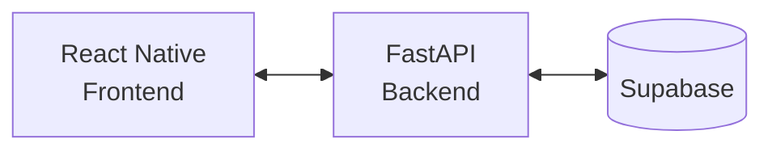

# Teto Justo


O **Teto Justo** organiza a convivência em casas compartilhadas: cadastra casas
e moradores, cria e atribui tarefas e acompanha sessões e responsabilidades,
tornando a divisão das atividades do lar mais clara e justa.

Protótipo de telas e fluxo no
[Figma](https://www.figma.com/design/xMTN0YQQvJrjXXuPWrQhMr/Untitled?node-id=0-1&t=9VOn0ieYSl2Ssmk3-1).

## Tecnologias

- **Frontend:** React Native, Expo (SDK 57), Expo Router, TypeScript. Estado
  global com Zustand; token de sessão em Expo SecureStore (celular) e
  `localStorage` (web).
- **Backend:** Python, FastAPI, Pydantic, Uvicorn.
- **Dados:** Supabase.
- **Qualidade:** ESLint, Prettier, Ruff, Bandit, Pytest.
- **Containerização:** Docker e Docker Compose.

## Arquitetura



O app consome a API FastAPI, que concentra as regras de negócio e persiste no
Supabase.

## Fluxo do app

Após o login, o app lista as casas do usuário antes de liberar as abas. Uma
única casa abre sozinha; com várias, o usuário escolhe, e a última escolha é
lembrada enquanto a sessão for válida. **Trocar de casa**, no Início, volta à
seleção; sair da conta apaga a preferência. Tarefas, moradores e pontuação
usam a casa selecionada. Detalhes em
[seleção de casa](./contexto/sprint_3/selecao_casa.md).

- **Conta:** **Criar conta** envia um código de 5 dígitos por e-mail (Resend);
  com o código correto, entre com e-mail e senha. Ver
  [verificação de e-mail](./contexto/sprint_4/verificacao_email.md).
- **Casa:** **Criar casa** (na seleção ou em **Trocar de casa**) torna o criador
  administrador. **Entrar por convite** adiciona o usuário a uma casa existente.
- **Convites:** o administrador usa **Convidar morador** no Início para gerar e
  copiar um convite; ele vale por 24 h e serve a várias pessoas. Moradores não
  convidam. Ver [contrato da casa](./contexto/sprint_3/contrato_casa.md).

As rotas correspondentes (`POST /usuarios/codigo-verificacao`, `POST /usuarios/`,
`POST /casas/{id_casa}/convites`) estão na documentação interativa `/docs` do
backend.

## Como rodar localmente

### Pré-requisitos

- **Frontend:** Node.js 24.3+ e npm (Expo SDK 57).
- **Backend:** Python 3 e um projeto Supabase de teste com as variáveis de acesso.
- **Script de inicialização:** Docker Desktop com Docker Compose. Na execução
  manual sem containers, Python precisa estar disponível.

### Iniciar tudo com um comando no Windows

Na raiz do repositório, no PowerShell:

```powershell
.\dev.cmd
```

`dev.cmd` chama `scripts/dev.ps1` com política de execução temporária só para o
processo, sem liberar scripts permanentemente. O equivalente direto é
`powershell -NoProfile -ExecutionPolicy Bypass -File .\scripts\dev.ps1`. Uma
política de grupo que bloqueie scripts continua valendo; nesse caso, solicite a
liberação ao administrador.

O script verifica Node, npm e Docker, oferece instalar o que faltar via WinGet,
cria `.env` a partir de `.env.example` na primeira execução (preencha
`SUPABASE_URL` e `SUPABASE_KEY` com um projeto de teste e pressione Enter),
instala dependências com `npm ci`, sobe o backend, aguarda `/health` e abre o
Expo com QR code. Credenciais existentes são preservadas e nenhum valor privado
é exibido. A URL da API e o IP do Expo valem só para a execução.

No celular, instale o [Expo Go do SDK 57](https://expo.dev/go), conecte-se à
mesma rede e leia o QR code. Para indicar o IPv4 manualmente:

```powershell
.\dev.cmd -Ip 192.168.1.10
```

VPN, Wi-Fi com isolamento de dispositivos e firewall podem impedir a conexão;
libere as portas TCP 8000 e 8081 apenas na rede privada de desenvolvimento.
Confira o `/health` no navegador do celular antes de ler o QR; um túnel do Expo
sozinho não expõe o backend local.

Outras opções:

```powershell
.\dev.cmd -CheckOnly          # só confere dependências e configuração (saída 1 = pendência)
docker compose stop backend   # para os containers sem apagar volumes
.\scripts\test-dev.ps1        # testa o script (simula instaladores; não toca em Supabase)
```

O script **não cria banco, não aplica migrations e não executa os jobs de
penalidades/rotatividade**. `/health` não comprova credenciais nem o esquema do
Supabase. O comando usa HTTP na rede local e não substitui HTTPS para um APK
distribuído. Passo a passo em
[execução local](./contexto/sprint_3/execucao_local.md).

### Execução manual

As instruções abaixo sobem os serviços separadamente, como alternativa ao
`dev.cmd`.

#### 1. Variáveis de ambiente

Crie um `.env` na raiz (não versione) a partir de `.env.example`. Variáveis:

| Variável | Uso |
| --- | --- |
| `SUPABASE_URL`, `SUPABASE_KEY` (ou `SUPABASE_SECRET_KEY`) | Acesso ao Supabase. |
| `CORS_ORIGINS` | Origens do navegador, separadas por vírgula. |
| `CASA_CONVITE_SECRET` | Assina convites de casa (≥ 32 bytes). |
| `CRON_SECRET` | Autentica os jobs GET da Vercel. |
| `PENALIDADE_JOB_TOKEN`, `ROTATIVIDADE_JOB_TOKEN` | Opcionais, para as chamadas POST manuais dos jobs. |

Gere segredos com `python -c "import secrets; print(secrets.token_urlsafe(32))"`
(a partir da raiz) e guarde-os só no `.env` local ou no gerenciador de segredos
do ambiente, nunca no frontend, no repositório ou em logs. O mesmo
`CASA_CONVITE_SECRET` deve valer em todas as instâncias; se faltar ou for curto,
as rotas de convite respondem `503` e trocá-lo invalida convites emitidos.

**Migrations:** antes de iniciar com um banco existente, confira quais
migrations de `docs/migrations/` já foram aplicadas e aplique na ordem
(`14.sql`…`19.sql`), sem repetir as já existentes. `18.sql` cria as tabelas da
rotatividade automática; `19.sql` reconcilia saldo com histórico de eventos e só
deve ser aplicada após revisar `GET /casas/{id}/auditoria-score`; `27.sql`
(PR #99) adiciona `pertencer.ativo`. Contexto:
[revisão de casa e pertencer](./contexto/sprint_2/revisao_casa_pertencer.md) e
[alinhamento da sprint 2](./contexto/sprint_2/alinhamento_tarefas_pontuacao.md).

**Antes de distribuir**, siga a
[segurança pós-login](./contexto/sprint_3/seguranca_pos_login.md). O login mantém
contadores de tentativas em memória (5/e-mail ou 20/IP em 15 min → `429` com
`Retry-After`), reiniciados a cada restart e não compartilhados entre
instâncias; com proxy, configure só proxies confiáveis no Uvicorn.

#### 2. Backend

```powershell
cd src/backend
python -m venv venv
.\venv\Scripts\Activate.ps1
pip install -r requirements.txt
uvicorn main:app --reload
```

A API fica em `http://127.0.0.1:8000`; confirme em `/health`. Alternativa com
Docker, a partir da raiz: `docker compose up --build backend`.

#### Jobs agendados (penalidades e rotatividade)

O Vercel Cron chama `GET /jobs/penalidades` e `GET /jobs/rotatividades`,
autenticados por `Authorization: Bearer <CRON_SECRET>` (sem o segredo → `503`;
autenticação inválida → `401`; sucesso com `Cache-Control: no-store`). As
chamadas manuais `POST /jobs/penalidades` e `POST /jobs/rotatividades` usam os
tokens próprios em `X-Penalidade-Job-Token` / `X-Rotatividade-Job-Token`.

Penalidades marcam tarefas vencidas como `atrasada` e, após o atraso máximo,
`nao_feito`; repetir a chamada é seguro (não duplica `score_event`). Teste
manual em PowerShell usando o segredo já na sessão:

```powershell
Invoke-RestMethod -Method Get `
  -Uri "http://127.0.0.1:8000/jobs/penalidades" `
  -Headers @{ Authorization = "Bearer $env:CRON_SECRET" }
```

Teste de integração da rotatividade (banco Supabase **descartável**, acesso
`service_role`, migrations aplicadas incluindo `18.sql`, sem outros rodízios
ativos), a partir de `src/backend`:

```powershell
python -m pytest -q tests/test_rotatividade_integracao.py
```

Horários em `src/backend/vercel.json` (`5 3 * * *` = 03:05 UTC / 00:05 Brasília).
Cron Jobs rodam só em produção. Ativação na Vercel: Root Directory
`src/backend`, `CRON_SECRET` nas variáveis de Production, novo deploy e
acompanhamento em **Settings > Cron Jobs**. No plano Hobby cada job roda no
máximo uma vez por dia e não é repetido em caso de falha. O bloqueio de
rotatividade é local ao processo e não coordena instâncias; evite agendadores e
chamadas manuais concorrentes. Detalhes em
[rotina de penalidades](./contexto/sprint_2/rotina_penalidades.md) e
[balanceamento da rotatividade](./contexto/sprint_2/balanceamento_rotatividade.md).
Fontes Vercel: [quickstart](https://vercel.com/docs/cron-jobs/quickstart),
[gerenciamento](https://vercel.com/docs/cron-jobs/manage-cron-jobs),
[limites](https://vercel.com/docs/cron-jobs/usage-and-pricing).

#### 3. Frontend

```sh
cd src/frontend
npm ci
```

Rode `npm ci` na primeira execução ou após mudanças nas dependências. Para
dados reais, crie `src/frontend/.env.local` (ignorado pelo Git):

```env
EXPO_PUBLIC_API_URL=http://127.0.0.1:8000
```

No celular, troque `127.0.0.1` pelo IP da máquina na rede. `EXPO_PUBLIC_CASA_ID`
e `EXPO_PUBLIC_TETO_JUSTO_TOKEN` não são mais usados; remova-os de configurações
antigas. O token vem de `POST /sessoes/login` e é salvo no SecureStore ou
`localStorage`; a sessão expira em 24 h e **Sair da conta** a revoga via
`POST /sessoes/logout`.

No PowerShell, se `npm`/`npx` forem bloqueados pela política de scripts, use
`npm.cmd` e `npx.cmd`; no macOS e Linux, sem `.cmd`.

**Navegador:**

```sh
npm run web -- --port 8081
```

Acesse [Nova tarefa](http://localhost:8081/nova-tarefa) ou **Criar** na
navegação. Se a porta estiver ocupada, use `--port 8082` e ajuste o endereço.
**Criar tarefa** grava só tarefas comuns; a opção rotativa mostra prévia local.
Comportamento do formulário em
[frontend de tarefas](./contexto/sprint_2/frontend_tarefas.md).

**Celular com Expo Go** (SDK 57, mesma rede Wi-Fi):

```sh
npx expo start --go --port 8081
```

Leia o QR code com o Expo Go (Android) ou a câmera (iPhone). Se a rede impedir a
conexão, use `npx expo start --go --tunnel`. No iPhone, entre com a mesma conta
Expo no app e na CLI (`npx expo login`). `localhost` no celular aponta para o
próprio aparelho.

**Compilar no aparelho** (alternativa ao Expo Go; executam `expo run:*` e podem
gerar pastas nativas, ver [build local no Expo](https://docs.expo.dev/guides/local-app-development/)):

| Destino | Comando | Pré-requisitos |
| --- | --- | --- |
| Android | `npm run android -- --device` | Android Studio, SDK, Java e aparelho com depuração USB, ou emulador. |
| iPhone | `npm run ios -- --device` | Mac com Xcode e assinatura configurada. Não compila no Windows. |

**Ver alterações:** salve os arquivos com o servidor ativo; pressione `r` ou
recarregue a página. Limpe o cache web com `npm run web -- --clear`. Após uma
versão nativa, mudanças só em TypeScript costumam precisar apenas de `npm start`.

Tutorial com orientações de conexão no Windows em
[execução do frontend](./contexto/sprint_2/tutorial_execucao_frontend.md).

### Builds mobile (GitHub Actions)

- **APK/IPA sem assinatura:** `.github/workflows/mobile-build.yml`, acionado em
  **Actions → Build APK e IPA unsigned → Run workflow**. Informe só a URL
  pública HTTPS da API (embutida no app); não precisa de `EXPO_TOKEN` nem EAS.
  Baixe os artefatos (14 dias). O IPA é sem assinatura (assine com Sideloadly).
  Notificações no APK: [configuração FCM](contexto/sprint_4/notificacoes_push.md#configuração-fcm-pelo-github-actions).
- **Release com EAS:** `.github/workflows/mobile-release.yml`, acionado por tag
  `v*`. Requer `EXPO_TOKEN` nos secrets, credenciais Apple configuradas uma vez
  via `npx eas-cli@latest build` e `expo.version` atualizado em `app.json` antes
  de cada tag. O IPA interno só instala nos aparelhos do perfil de
  provisionamento. Passo a passo em
  [releases mobile](./contexto/sprint_2/releases_mobile.md).

Não configure tokens de sessão no EAS, no GitHub ou em `EXPO_PUBLIC_*`: eles
ficam legíveis no app distribuído. Configure só a URL pública (HTTPS). Pendências
de distribuição em [autenticação da sprint 2](./contexto/sprint_2/autenticacao.md).

## Qualidade de código

### Backend (Ruff e Bandit)

Na pasta `src/backend`, com o ambiente virtual ativo (`(venv)` no prompt; se a
ativação for bloqueada, `Set-ExecutionPolicy -Scope Process -ExecutionPolicy RemoteSigned`):

```powershell
pip install ruff bandit
ruff check .                      # linting (--fix corrige o possível)
ruff format .                     # formatação
bandit -r . -x ./venv,./tests     # SAST; priorize achados High/Medium
```

Regras em `src/backend/ruff.toml`. Antes de commitar, rode `ruff check`,
`ruff check --fix`, `ruff format` e `bandit`, revisando as correções. Saia do
ambiente com `deactivate`.

### Frontend

Dentro de `src/frontend`:

```sh
npm run lint
npx tsc --noEmit
```

O lint global tem pendências de formatação registradas no contexto da sprint 2;
uma falha ali não impede, por si só, o servidor de desenvolvimento de iniciar.

## Contexto do projeto

A pasta [`contexto/`](./contexto/) reúne resumos técnicos por sprint: objetivo
de cada entrega, arquivos e comportamentos alterados, decisões, validações
executadas e pendências. Ao concluir uma alteração, crie ou atualize o resumo
em `contexto/sprint_N/` com um nome curto (ex.: `autenticacao.md`), sem incluir
dados sensíveis.
